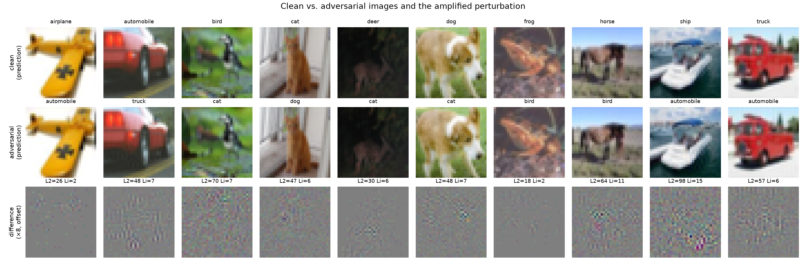

# Black-Box Adversarial Attack on a CNN (Problem 2)

A decision-based (**hard-label**) black-box attack that produces one adversarial
`.png` for each of the 1000 provided CIFAR-10 images.

The attacker may query the provided CNN at arbitrary inputs and read the
**predicted label**, and nothing else. This repository honours that literally:
the model is reachable only through `src/oracle.py`, whose entire public surface
is

```python
oracle.predict(x01)            # -> int64 labels
oracle.is_adversarial(x01, y)  # -> bool mask
```

No architecture, parameters, logits, probabilities or intermediate activations
are read anywhere in the attack. Every forward pass is counted, so the reported
inference budget is exact.

<!--RESULTS-->

## Results

Measured by reading the 1000 submitted `.png` files back from disk and querying
the provided model:

| | |
| --- | --- |
| **Attack success rate** | **100.0 %** (1000/1000 images misclassified) |
| L2 per image (0-255 scale) | mean **59.0**, median 58.3, max 205.3 |
| L-inf per image (0-255 scale) | mean **6.9**, median 7, max 26 |
| RMSE (0-255 scale) | mean **1.06** pixel levels |
| PSNR | mean **49.00 dB**, median 47.68 dB |
| SSIM | mean **0.99762**, min 0.9832 |
| Changed pixel values | 1489 of 3072 (48 %) |
| Model inferences | 16,899,931 total, **16,900 per image** |

A mean RMSE of 1.06 pixel levels means the average pixel value moves by
about one quantisation step — the smallest change an 8-bit image can hold —
and 52 % of all pixel values are left bit-identical. The noise is
invisible at 1:1; the difference images in `report/` are amplified 8x to show
anything at all.



## Repository layout

```
PS-2/
├── p2_code.ipynb               the completed notebook — the submission artefact
├── run_final.sh                the exact command that produced adv_images/
├── README.md                   this file
├── adv_images/                 1000 adversarial PNGs, <class>_<index>_adv.png
├── report/
│   ├── report.pdf              the short report on the method
│   ├── examples.png            clean vs. adversarial vs. amplified difference
│   ├── distortion.png          distribution of L2 / L-inf / PSNR / SSIM
│   ├── metrics_final.json      measured results for the submitted images
│   ├── ablation.json           what each design choice is worth
│   └── final_config.json       the parameters carried by the notebook
├── shared-files/
│   └── p2_code.ipynb           the organisers' original notebook template
└── src/
    ├── oracle.py               the only point of contact with the victim:
    │                           returns hard labels, counts every forward pass
    ├── attack.py               every attack stage — free seeds, bisection onto
    │                           the boundary, HopSkipJump, geometric (SurFree)
    │                           and random (Boundary-Attack) walks, tail rescue,
    │                           8-bit finalisation, grid-space refinement,
    │                           integer polish
    ├── verify.py               the robustness test the final images must pass:
    │                           a distortion margin, checked across several
    │                           backends and input representations
    ├── run_attack.py           end-to-end driver; writes adv_images/ and
    │                           report/metrics_final.json
    ├── notebook_driver.py      the same pipeline as one function, inlined into
    │                           the notebook
    ├── surrogate.py            substitute-network architectures, training on
    │                           victim-queried labels, DDN and PGD attacks
    ├── transfer.py             turns surrogate gradients into candidate
    │                           directions; the victim's labels pick the radius
    ├── cifar.py                the public CIFAR-10 split used to train the
    │                           substitutes
    ├── data.py                 loads the clean images in the notebook's order;
    │                           writes the adversarial PNGs
    ├── metrics.py              L2 / L-inf / L0 / RMSE / PSNR / SSIM and the
    │                           attack success rate
    ├── build_notebook.py       builds p2_code.ipynb by inlining the real
    │                           source, so the notebook runs the same code that
    │                           produced the images
    ├── test_notebook.py        executes the generated notebook end to end on a
    │                           reduced budget and checks the PNGs it writes
    ├── reharden.py             re-applies verify.py's test to an existing
    │                           adv_images/ without redoing the attack
    ├── finish.py               re-measures the saved PNGs, syncs the notebook
    │                           config, builds the figures and the report
    ├── make_figures.py         the two figures in report/
    ├── make_report.py          builds report/report.pdf
    ├── sweep.py                hyper-parameter sweeps; produced the ablation
    │                           table in the report
    ├── diag_hsja.py            HopSkipJump convergence and probe-balance
    │                           diagnostics
    └── diag_model.py           black-box characterisation of the victim (clean
                                accuracy, label stability under corruptions)
```

To read the method, start at `src/oracle.py` (what the attack is allowed to
see), then `src/attack.py` (the stages, in the order a run uses them), then
`src/verify.py` (what the final images have to survive).

## Reproducing

```bash
# 1. environment (a CUDA build of PyTorch; CPU also works, just slower)
python3.11 -m venv .venv
.venv/bin/pip install torch torchvision numpy pillow matplotlib reportlab

# 2. unpack the organiser-provided archive.  p2_data.zip is not committed
#    (44 MB); drop the organisers' copy into shared-files/ first.
mkdir -p data && unzip shared-files/p2_data.zip -d data/

# 3. run the attack (writes adv_images/ and report/metrics_final.json)
bash run_final.sh               # or: .venv/bin/python src/run_attack.py --help

# 4. re-measure the saved files, build figures + report
.venv/bin/python src/finish.py
```

`p2_code.ipynb` is self-contained and does the same thing in two cells; it is
the submission artefact. `src/test_notebook.py` runs it end to end (on a
reduced budget) and checks that it writes 1000 correctly named 32x32 RGB PNGs
that are still adversarial when read back from disk.

## Method

The attack minimises the perturbation norm subject to the label actually
changing, using nothing but the ±1 answer "did the label change?".

### 0 - Free adversarial seeds (0 queries)

The victim classifies all 1000 provided images correctly. Therefore any clean
image whose label differs is *already* an adversarial example for a given
image. Taking the nearest such images in pixel space gives a strong starting
point without spending a single query, instead of the usual "sample random
noise until it is misclassified" phase. The nearest one is also a valid 8-bit
PNG, so recording it immediately puts a **100 % success-rate floor** under the
whole run: later stages only ever replace it with something closer that the
oracle has confirmed.

### 1 - Substitute-model directions, oracle-decided radii

Four small CIFAR-10 networks (two ResNet variants, two VGG variants) are
trained locally **on labels queried from the victim** — the substitute-model
construction of Papernot et al. (2017). That costs 60 000 queries once, shared
by all 1000 images (60 per image), and it uses no information the black box
does not hand out: the surrogates learn the victim's own decision function from
hard labels alone.

The ensemble then supplies candidate *directions* — a minimum-norm DDN attack
(Rony et al., 2019), L2 and L-inf PGD, the plain ensemble gradient, and one DDN
direction per network. The surrogates never decide whether an image is
adversarial; for each direction the **victim's** labels are used to find the
smallest radius along it that flips the label, by a geometric sweep followed by
bisection. The closest confirmed point over all directions is the starting
point.

On the full 1000 images this stage alone reaches a median L2 of **70.5**
(0-255 scale) for **275 queries per image** — a level the pure query-only
pipeline needs roughly 20 000 queries to match. Everything after it is
refinement of an already-good starting point.

### 2 - HopSkipJump (optional)

Estimating the boundary normal by Monte-Carlo from ±1 answers, stepping along
it and re-projecting (Chen, Jordan & Wainwright, *IEEE S&P* 2020). Two
implementation details mattered a lot:

* **the re-projection has to be fine.** The probe radius is `γ·dist/d` with
  d = 3072, which is tiny; if the re-projected point sits further inside the
  adversarial region than that, almost every probe answers "still adversarial",
  the estimator saturates and progress stalls. Deepening the bisection from 10
  to 20 steps moved the measured probe balance from 0.75 (saturated) to 0.40
  and cut the median L2 from 210 to 134 at the same budget.
* **low-frequency probing hurt.** Restricting probes to a smooth upsampled
  subspace is a standard query-efficiency trick (QEBA), but this model needs
  high-frequency perturbations: at an equal budget the median L2 was 141 in
  full space against 165, 247 and 563 for 3·16·16, 3·8·8 and 3·4·4 subspaces.

With the transfer stage in front of it, HopSkipJump no longer earns its keep,
and the final configuration skips it (`--iters 0`). It is kept in the code
because it is what makes the pure query-only variant work.

### 3 - Boundary refinement

Near convergence a fresh normal estimate costs hundreds of queries for a small
gain, so the attack switches to two much cheaper moves:

* a **geometric step** (SurFree, Maho, Furon & Le Merrer, *CVPR* 2021). With
  `u` the unit vector from the clean image to the current point at distance
  `d`, and `v` random and orthogonal to `u`,
  `z(t) = x + d·cos t·(cos t·u + sin t·v)` lies at distance `d·cos t`, so a
  single accepted query shrinks the distance by `cos t`. Several `t` are tried
  per step in one batch, the largest accepted one is kept, the angle adapts per
  image, and the radius is periodically re-bisected.
* a **random walk along the boundary** (Brendel, Rauber & Bethge, *ICLR* 2018):
  one orthogonal trial at constant distance plus one inward trial. The inward
  trial does not depend on the outcome of the orthogonal one, so both are
  answered in a single batched call, and both step sizes adapt per image to the
  observed acceptance rate.

A **tail-rescue** pass then spends extra steps only on the images that are
still furthest away. Because queries are batched, refining a subset costs
proportionally less, which is a cheap way to pull in the few images where the
noise would otherwise be visible.

### 4 - Surviving 8-bit quantisation

The deliverable is a PNG, so the perturbation has to survive rounding to the
integer pixel grid. This is not a detail here — the converged perturbation is
about one pixel level per channel in RMS, the same order as the quantisation
step itself, so a point on the continuous boundary rounds to the wrong side
roughly half the time. Three families of candidates are tried and the closest
one the oracle confirms is kept: dithered (stochastic, unbiased) roundings; the
smallest *scaling* of the perturbation whose rounding still works, found by a
geometric sweep far enough that it cannot fail silently, then bisected; and
dithered roundings at that scale.

A **grid-space refinement** round then runs the same geometric and random walks
with the oracle rounding every query onto the 8-bit grid and the tracker
measuring rounded candidates. That optimises the quantity that is actually
graded, rather than a continuous optimum that lies below the grid.

### 5 - Integer-grid polish

Three passes, all on integer pixel values and all oracle-verified, so none can
make the result worse: binary search for the smallest L-inf clipping radius
that still flips the label; binary search for the largest threshold below which
components can be pruned to zero; and greedy group-wise shrinking of the rest
by one level.

### 6 - Verification that survives a change of machine

Points driven onto the decision boundary are separated from the correct label
by a numerically tiny margin. Three separate things were observed to flip the
label back:

* **batch size** — cuDNN picks its convolution kernel partly from the tensor
  shape, so an image can be classified differently in a batch of 13 and a batch
  of 1000;
* **tensor layout** — a PIL/`ToTensor` loader returns a *non-contiguous*
  permuted view, which takes a different kernel than the contiguous tensor the
  attack computed;
* **one unit in the last place** — dividing a uint8 tensor by 255 on the CPU
  and on the GPU are not bit-identical (CUDA may multiply by the reciprocal), a
  ~6e-8 difference that is nevertheless enough.

Enumerating every combination a grader might use is hopeless, so the test is
not "does it pass on many backends" but "does it pass **with room to spare**":
an image is accepted only if the perturbation **shrunk to 97 %** is still
adversarial. A point that survives being pulled back towards the clean image is
not sitting on the boundary, so a last-bit difference cannot argue it out of
its label. The margin test is applied across five evaluators (three GPU batch
sizes, two CPU batch sizes) and four input representations, including the exact
one a PNG loader produces; images without a margin are scaled up along their
own direction in 5 % steps, with the whole set re-verified after each step.

Insisting on this was cheap and necessary: 19 of the 1000 images needed scaling
up, which moved the mean L2 from 58.99 to 59.01 — and without it, 7 images that
verified in memory were no longer adversarial once read back from disk.

Finally the written files are read back, compared byte-for-byte with the
verified tensors, and re-checked: **1000/1000** adversarial, and 1000/1000
still adversarial at 97 % of the perturbation.

## Notes on the threat model

* Only `argmax` labels are used. `Oracle.predict` defensively takes `argmax` if
  a model ever returned a score vector, and discards the scores in the same
  expression, so no confidence value can leak into the attack.
* The oracle was checked to be deterministic and batch-composition independent
  before attacking (the `[check]` lines of every run).
* The substitute networks are trained on CIFAR-10 images labelled by querying
  the victim, and that cost is charged to the query budget. Replacing those
  labels with CIFAR-10's ground truth changes little in practice — the victim
  agrees with the ground truth on 99.99 % of the training split and 94.82 % of
  the test split — but querying keeps the method strictly inside the stated
  threat model.
* `--no-transfer` runs the pure query-only variant, which uses no substitute
  model at all. It is exercised as part of validation and reaches 100 % success
  with the same robustness guarantee, just at a larger distortion for a given
  budget; the ablation table in the report gives numbers for both.
* Queries made for the final verification pass use separate counters and are
  reported separately from the attack budget.
